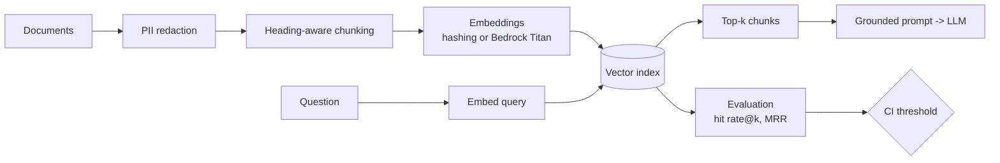

# rag-ingestion-pipeline

The data engineering side of Retrieval-Augmented Generation: load documents, **redact PII before anything is embedded**, split them into heading-aware chunks, embed, index, retrieve, and **measure retrieval quality in CI** so a change to chunking or embeddings cannot silently make answers worse.

> **Portfolio note.** An independently written, representative project. The six documents in `data/docs` describe an invented company and were written for this repo. No employer or client code, documents or data are used.

## Why this matters

Most RAG failures are data failures: the right passage was never retrieved because it was split badly, duplicated, stale, or never indexed; or sensitive data was embedded and can now be surfaced to anyone. Treating the corpus as a governed pipeline, with tests and a quality metric, fixes most of that before a model is involved.

## What it does

| Stage | Implementation |
|---|---|
| Load | `.md` / `.txt` from a folder; title from first heading |
| Redact | Email, phone, SSN and card patterns replaced with `[LABEL]` before embedding; counts reported |
| Chunk | Splits on markdown headings first, then word windows with overlap; stable, content-hashed chunk IDs |
| Embed | Pluggable `Embedder` interface. Default `HashingEmbedder` is offline and deterministic; `BedrockEmbedder` (Amazon Titan) included for managed embeddings |
| Index | Cosine-similarity index with metadata filter, idempotent re-ingest, save/load to disk |
| Retrieve + prompt | Top-k chunks and a grounded prompt that cites sources as `[n]` and allows "I don't know" |
| Evaluate | Hit rate@k and MRR against a labelled question set; CI fails below a threshold |



## Quick start

```bash
python -m venv .venv && source .venv/bin/activate
pip install -e ".[dev]"
pytest -q

rag ingest --docs data/docs --index build/index
rag ask "Who must approve access to a confidential table?" --index build/index --show-prompt
rag eval --index build/index -k 3 --min-hit-rate 0.9
```

Sample output:

```text
{"documents": 6, "chunks": 19, "redactions": {"EMAIL": 1, "PHONE": 1}}

{ "questions": 12, "k": 3, "hit_rate": 1.0, "mrr": 1.0, "misses": [] }
```

Docker: `docker build -t rag-pipeline . && docker run --rm rag-pipeline`

### Using managed embeddings (Amazon Bedrock)

```bash
pip install -e ".[bedrock]"      # credentials from the standard AWS chain (env, profile, role)
```

```python
from rag_pipeline.embeddings import BedrockEmbedder
from rag_pipeline.pipeline import ingest
index, stats = ingest("data/docs", embedder=BedrockEmbedder(region="us-east-1"))
```

The Bedrock path is not exercised in CI because it needs an AWS account.

## Project layout

```
src/rag_pipeline/  documents.py  pii.py  embeddings.py  index.py  pipeline.py  cli.py
data/docs/         six synthetic policy documents
data/              eval_questions.jsonl (question -> expected document)
tests/             pytest suite, including the retrieval-quality threshold
```

## Tech stack

Python 3.10+, NumPy, pytest, ruff, Docker, GitHub Actions; optional boto3 / Amazon Bedrock.

## Security considerations

- Redaction runs before embedding, so raw identifiers never reach the index or an external embedding API.
- Regex redaction is a baseline only. For regulated (HIPAA, GDPR) content add a trained detector such as Amazon Comprehend or Microsoft Presidio, and index only documents whose classification allows it.
- No keys in code or config; AWS access uses the default credential chain.
- Container runs as a non-root user.

## Limitations and next steps

- The bundled evaluation is deliberately small (12 questions, 6 documents) and the default embedder is lexical, so the perfect score shows the harness works, not that it would hold on a large corpus. A real corpus needs a larger labelled set and semantic embeddings.
- In-memory numpy index; production would use OpenSearch k-NN, pgvector, Databricks Vector Search or Azure AI Search behind the same interface.
- Next: PDF/HTML loaders, hybrid (BM25 + vector) retrieval, re-ranking, incremental ingestion keyed on document hashes, and a FastAPI endpoint.

## License

MIT
